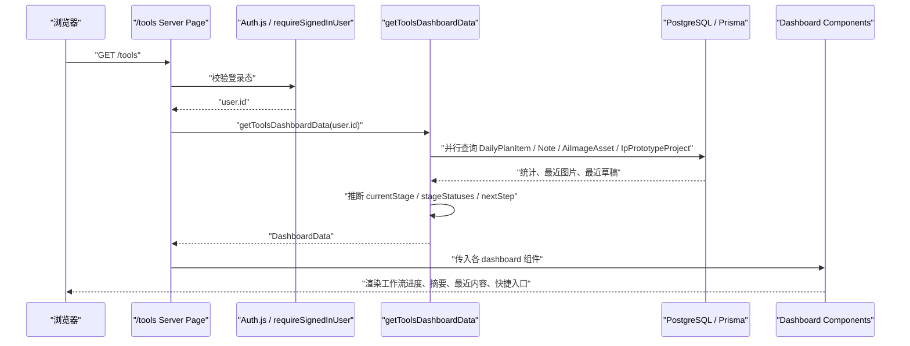
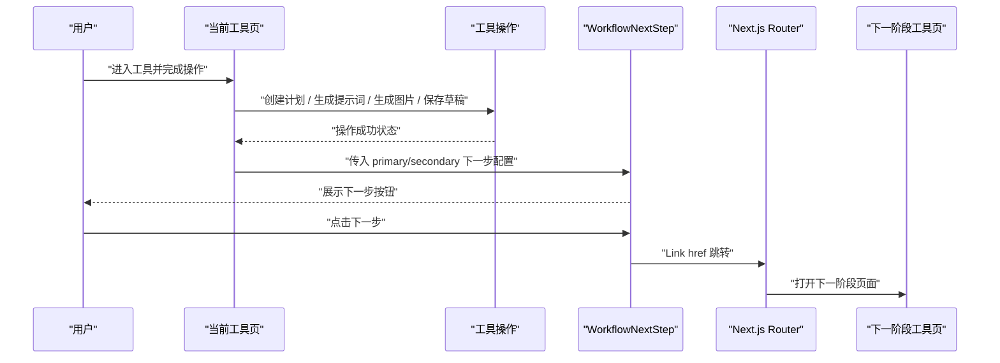

# Xenia 工具台工作流重构架构方案

## 1. 实现方案概述

### 1.1 整体改造策略

本次重构不改变项目技术栈，不新增数据库表，优先通过路由整理、导航配置抽象、服务端聚合查询和可复用 UI 组件完成 P0 需求。

核心策略：

1. **导航从页面硬编码转为配置驱动**
   - 使用 `src/components/tools/nav-config.ts` 维护总览入口、4 个分组、组内工具、图标和路由。
   - `workspace-shell.tsx` 只负责渲染分组导航、移动端导航和激活态。

2. **总览页从静态卡片变为服务端仪表盘**
   - `/tools` 作为工作流仪表盘。
   - 服务端 `getToolsDashboardData(userId)` 聚合 `DailyPlanItem`、`Note`、`AiImageAsset`、`IpPrototypeProject`。
   - 前端组件只消费已规整的数据，不直接写 Prisma 查询。

3. **服装类工具统一到一个入口**
   - 新入口：`/tools/fashion-prompts`。
   - Tab：`通用 / 男装 / 女装`。
   - 复用现有 `OutfitPromptWorkbench`，通过 `fixedGender` 控制子模式。
   - 原 `/tools/menswear`、`/tools/womenswear`、`/tools/outfit-image` 只保留重定向，避免外部链接 404。

4. **工具间只做 P0 UI 引导，不做数据强绑定**
   - 页面底部或操作结果区增加“下一步”引导组件。
   - P0 跳转链路：计划中心 → AI 生图；服装/零食提示词 → AI 生图；AI 生图/IP 原型 → 写文章或返回工作台。
   - 不在 P0 修改 `DailyPlanItem`、`AiImageAsset`、`Note` 的关联关系。

5. **遗留入口收口**
   - `/tools/directory` 301 重定向到 `/tools/sites`。
   - 模型配置从工具导航移除，保留 `/account/models`；是否新增 `/account/settings` 作为 P1/P2 决策。

### 1.2 当前代码基础

当前项目已经具备部分目标结构：

- `src/components/tools/nav-config.ts` 已存在 4 组导航配置。
- `src/components/tools/workspace-shell.tsx` 已使用分组导航。
- `src/app/tools/page.tsx` 已改为动态总览页。
- `src/server/tools-dashboard.ts` 已有总览聚合查询与阶段推断。
- `src/lib/workflow.ts` 已定义四阶段、阶段状态和下一步配置。
- `src/app/tools/fashion-prompts/page.tsx` 与 `src/components/tools/fashion-prompts-workbench.tsx` 已存在。

后续 P0 重点是补齐重定向、统一引导组件、确认总览组件验收、移除导航残留和补测试。

### 1.3 改动范围

需要新建：

- 工作流下一步引导组件。
- 路由重定向文件或 `next.config.ts` redirect 配置。
- 总览页/导航/服装合并相关测试。

需要修改：

- 工具页底部增加下一步引导。
- `/tools/page.tsx` 和 dashboard 组件按 PRD 做最终视觉与数据验收。
- `workspace-shell.tsx`、`nav-config.ts` 做导航 P0 验收。
- 原服装路由和 directory 路由改为 301 重定向。

不建议删除：

- 原服装页面目录和 directory 页面可以先保留为 redirect route，降低链接断裂风险。
- `tool-directory.tsx` 与 `tool-directory-data.ts` 可标记废弃，P1 再删除。

## 2. 框架选型

### 2.1 技术栈

保持不变：

- Next.js App Router
- TypeScript
- Tailwind CSS
- Prisma
- PostgreSQL
- Auth.js

### 2.2 渲染策略

- `/tools` 总览页使用 Server Component + `dynamic = "force-dynamic"`，保证每日任务、草稿、生图数量实时。
- 工具表单页继续使用 Client Component。
- 导航壳 `WorkspaceFrame` 继续使用 Client Component，因为需要 `usePathname` 和分组展开状态。

### 2.3 新增依赖

P0 不新增 npm 依赖。现有 `lucide-react`、Tailwind、Next.js 组件足够覆盖 UI。

## 3. 文件列表及相对路径

### 3.1 新建文件

```text
src/components/tools/workflow-next-step.tsx
src/components/tools/fashion-prompts-workbench.tsx          # 如果当前分支不存在则新建；当前代码已存在
src/app/tools/fashion-prompts/page.tsx                      # 如果当前分支不存在则新建；当前代码已存在
src/server/tools-dashboard.ts                               # 如果当前分支不存在则新建；当前代码已存在
src/lib/workflow.ts                                         # 如果当前分支不存在则新建；当前代码已存在
src/components/tools/workflow-progress-bar.tsx              # 当前代码已存在时只校验
src/components/tools/dashboard-summary-cards.tsx            # 当前代码已存在时只校验
src/components/tools/dashboard-recent-images.tsx            # 当前代码已存在时只校验
src/components/tools/dashboard-recent-drafts.tsx            # 当前代码已存在时只校验
src/components/tools/dashboard-quick-actions.tsx            # 当前代码已存在时只校验
tests/tools-dashboard.test.ts
tests/nav-config.test.ts
tests/fashion-prompts-routing.test.ts
```

### 3.2 修改文件

```text
src/components/tools/workspace-shell.tsx
src/components/tools/nav-config.ts
src/app/tools/page.tsx
src/app/tools/plan/page.tsx
src/app/tools/ai-image/page.tsx
src/app/tools/ip-prototype/page.tsx
src/app/tools/snack-grocery/page.tsx
src/app/tools/menswear/page.tsx
src/app/tools/womenswear/page.tsx
src/app/tools/outfit-image/page.tsx
src/app/tools/directory/page.tsx
src/components/tools/daily-plan-panel.tsx
src/components/tools/ai-image-tool.tsx
src/components/tools/ip-prototype-workbench.tsx
src/components/tools/outfit-prompt-workbench.tsx
src/components/tools/snack-grocery-prompt-workbench.tsx
next.config.ts                                              # 可选：集中配置 permanent redirects
```

### 3.3 删除/废弃文件

P0 不直接删除，先废弃：

```text
src/components/tools/tool-directory.tsx
src/components/tools/tool-directory-data.ts
src/app/tools/directory/page.tsx                            # 保留为 redirect route
src/app/tools/menswear/page.tsx                             # 保留为 redirect route
src/app/tools/womenswear/page.tsx                           # 保留为 redirect route
src/app/tools/outfit-image/page.tsx                         # 保留为 redirect route
```

P1 可删除前提：

- 线上访问日志确认旧路由无人使用。
- sitemap、内部链接、外部入口均已更新。

## 4. 数据结构和接口

### 4.1 TypeScript 类型定义

#### 工作流类型：`src/lib/workflow.ts`

```ts
export type WorkflowStage = "plan" | "create" | "generate" | "publish";

export type WorkflowStageStatus = "completed" | "active" | "pending";

export type WorkflowStageMeta = {
  id: WorkflowStage;
  label: string;
  description: string;
  icon: LucideIcon;
};

export type NextStepConfig = {
  label: string;
  href: string;
  stage: WorkflowStage;
};
```

#### 导航类型：`src/components/tools/nav-config.ts`

```ts
export type NavItem = {
  id: string;
  label: string;
  href: string;
  icon: LucideIcon;
};

export type NavGroup = {
  id: string;
  label: string;
  icon: LucideIcon;
  items: NavItem[];
};
```

#### 总览数据类型：`src/server/tools-dashboard.ts`

```ts
export type DashboardSummary = {
  todayTaskTotal: number;
  todayTaskCompleted: number;
  draftCount: number;
  todayImageCount: number;
  ipProjectCount: number;
};

export type DashboardRecentImage = {
  id: string;
  title: string;
  imageUrl: string;
  createdAt: string;
};

export type DashboardRecentDraft = {
  id: string;
  title: string;
  slug: string;
  updatedAt: string;
};

export type DashboardData = {
  summary: DashboardSummary;
  recentImages: DashboardRecentImage[];
  recentDrafts: DashboardRecentDraft[];
  currentStage: WorkflowStage;
  stageStatuses: WorkflowStageStatus[];
  nextStep: NextStepConfig;
};
```

#### 服装合并 Tab 类型

```ts
export type FashionPromptsTab = "general" | "menswear" | "womenswear";

export type FashionPromptsWorkbenchProps = {
  initialTab: FashionPromptsTab;
};
```

#### 下一步引导组件类型

```ts
export type WorkflowNextStepProps = {
  title?: string;
  description?: string;
  primary: NextStepConfig;
  secondary?: NextStepConfig;
};
```

### 4.2 API 路由

P0 不新增 REST API。总览页直接在 Server Component 中调用服务端查询：

```ts
const user = await requireSignedInUser("/tools");
const data = await getToolsDashboardData(user.id);
```

沿用现有 API：

```text
GET/POST/PATCH/DELETE /api/daily-plan
POST /api/tools/image-generation
GET /api/tools/image-assets
GET/POST /api/tools/ip-prototypes
GET/POST /api/website-bookmarks
```

### 4.3 组件接口设计

#### `WorkspaceFrame`

职责：

- 渲染桌面侧边栏。
- 渲染移动端横向导航。
- 根据 `pathname` 计算当前分组和当前项。

接口：

```ts
type WorkspaceFrameProps = {
  children: ReactNode;
  userLabel: string;
};
```

#### `WorkflowProgressBar`

职责：

- 展示四阶段进度。
- 显示当前阶段和下一步按钮。

接口：

```ts
type WorkflowProgressBarProps = {
  currentStage: WorkflowStage;
  stageStatuses: WorkflowStageStatus[];
  nextStep: NextStepConfig;
};
```

#### `WorkflowNextStep`

职责：

- 用于各工具页底部或操作成功区域。
- 只做 UI 跳转，不写数据库。

接口：

```ts
type WorkflowNextStepProps = {
  title?: string;
  description?: string;
  primary: NextStepConfig;
  secondary?: NextStepConfig;
};
```

#### `FashionPromptsWorkbench`

职责：

- 管理通用/男装/女装 Tab。
- 复用 `OutfitPromptWorkbench`。

接口：

```ts
type FashionPromptsWorkbenchProps = {
  initialTab: "general" | "menswear" | "womenswear";
};
```

## 5. 程序调用流程（时序图）

### 5.1 总览页数据加载流程



### 5.2 工具间引导跳转流程



## 6. 任务列表（有序、含依赖关系）

| 任务编号 | 任务描述 | 涉及文件 | 依赖任务 | 复杂度 |
| --- | --- | --- | --- | --- |
| T01 | 审核并冻结工作流常量，确认四阶段、下一步配置、导航配置无模型配置和旧 directory | `src/lib/workflow.ts`, `src/components/tools/nav-config.ts` | 无 | 低 |
| T02 | 完成工具台侧边栏分组导航验收，桌面端默认展开当前组，移动端使用扁平横向导航 | `src/components/tools/workspace-shell.tsx`, `src/components/tools/nav-config.ts` | T01 | 中 |
| T03 | 完成 `/tools` 总览页服务端数据聚合与类型稳定 | `src/server/tools-dashboard.ts`, `src/app/tools/page.tsx` | T01 | 中 |
| T04 | 完成总览页 UI 组件验收：工作流进度、4 张摘要卡、最近生图、最近草稿、快速操作 | `workflow-progress-bar.tsx`, `dashboard-summary-cards.tsx`, `dashboard-recent-images.tsx`, `dashboard-recent-drafts.tsx`, `dashboard-quick-actions.tsx` | T03 | 中 |
| T05 | 新建/确认服装合并页 `/tools/fashion-prompts`，Tab 支持 `general/menswear/womenswear` | `src/app/tools/fashion-prompts/page.tsx`, `src/components/tools/fashion-prompts-workbench.tsx`, `src/components/tools/outfit-prompt-workbench.tsx` | T01 | 中 |
| T06 | 将原服装路由改为 301 重定向并携带 tab 参数 | `src/app/tools/menswear/page.tsx`, `src/app/tools/womenswear/page.tsx`, `src/app/tools/outfit-image/page.tsx` 或 `next.config.ts` | T05 | 低 |
| T07 | 将 `/tools/directory` 改为 301 重定向到 `/tools/sites` | `src/app/tools/directory/page.tsx` 或 `next.config.ts` | T01 | 低 |
| T08 | 新建 `WorkflowNextStep` 组件，统一底部引导样式 | `src/components/tools/workflow-next-step.tsx` | T01 | 低 |
| T09 | 在计划中心加入“去生成素材”引导 | `src/app/tools/plan/page.tsx`, `src/components/tools/daily-plan-panel.tsx` | T08 | 中 |
| T10 | 在服装起号和零食百货工具加入“去 AI 生图”引导 | `fashion-prompts-workbench.tsx`, `outfit-prompt-workbench.tsx`, `snack-grocery-prompt-workbench.tsx` | T08, T05 | 中 |
| T11 | 在 AI 生图加入“写文章发布”或“返回工作台”引导 | `src/components/tools/ai-image-tool.tsx` | T08 | 中 |
| T12 | 在 IP 原型工坊加入“去 AI 生图 / 写文章发布”引导 | `src/components/tools/ip-prototype-workbench.tsx` | T08 | 中 |
| T13 | 从所有工具导航和总览快捷入口中移除模型配置，保留 `/account/models` 入口 | `nav-config.ts`, `dashboard-quick-actions.tsx`, `account` 相关页面 | T01 | 低 |
| T14 | 补单元测试：导航分组、阶段推断、dashboard 数据形状、服装 tab 解析 | `tests/nav-config.test.ts`, `tests/tools-dashboard.test.ts`, `tests/outfit-prompt-workbench.test.ts` | T01-T05 | 中 |
| T15 | 补路由行为测试或最小 smoke：旧路由重定向、新路由 200 | `tests/fashion-prompts-routing.test.ts` 或 Playwright/smoke 脚本 | T06, T07 | 中 |
| T16 | 回归验证：`npm test`、`npm run lint`、`npm run build`，启动 3001 检查关键页面 | 项目根目录 | T01-T15 | 低 |

## 7. 依赖包列表

P0 不新增依赖。

继续使用：

```text
next
react
typescript
tailwindcss
prisma
@auth/core / next-auth
lucide-react
```

如后续做 P1/P2：

- 若增加图表型周报，可评估 `recharts`，但 P0 不引入。
- 若做复杂可拖拽工作流模板，可评估 `@dnd-kit/*`，但 P0 不引入。

## 8. 共享知识（跨文件约定）

### 8.1 组件命名规范

- 工具台壳组件：`Workspace*`
- 工作流组件：`Workflow*`
- 总览页组件：`Dashboard*`
- 工具表单组件：`*Workbench`
- 配置文件：`*-config.ts`
- 服务端聚合查询：`server/*-dashboard.ts` 或 `server/*-queries.ts`

### 8.2 样式约定

- 继续使用 Tailwind CSS。
- 工具台容器使用白底、细边框、`rounded-2xl`、轻阴影，保持现有视觉。
- 工具页不做营销型 hero，保持工作台密度。
- 卡片只用于独立工具块、数据摘要、结果画廊，不做卡片套卡片。
- 移动端导航使用横向滚动，避免侧边栏挤压内容。

### 8.3 路由约定

- 总览：`/tools`
- 规划：`/tools/plan`
- 创作：`/tools/ai-image`、`/tools/ip-prototype`
- 电商：`/tools/fashion-prompts`、`/tools/snack-grocery`
- 资源：`/tools/sites`
- 废弃路由：
  - `/tools/menswear` → `/tools/fashion-prompts?tab=menswear`
  - `/tools/womenswear` → `/tools/fashion-prompts?tab=womenswear`
  - `/tools/outfit-image` → `/tools/fashion-prompts?tab=general`
  - `/tools/directory` → `/tools/sites`

### 8.4 数据约定

- P0 不新增表，不新增字段。
- dashboard 查询必须按 `authorId` 过滤，避免多用户数据串读。
- 今日统计使用 `server/daily-plan.ts` 的日期工具，避免时区口径分裂。
- `AiImageAsset` 最近图直接用原图 URL 缩放展示，不新增缩略图存储。

### 8.5 权限约定

- `/tools` 及工具子页继续要求登录。
- 账户模型配置仍属于账户级设置，不属于工具导航。
- 所有 dashboard 数据必须由服务端基于当前 session user 查询。

## 9. 待明确事项

| 编号 | 问题 | 建议决策 | 影响 |
| --- | --- | --- | --- |
| Q1 | 模型配置最终是否新建 `/account/settings`？ | P0 先保留 `/account/models`，只从工具导航移除 | 影响账户页信息架构 |
| Q2 | “写文章发布”目标路由是 `/admin`、`/admin/content/new` 还是未来新编辑器？ | P0 暂用当前可用入口；实施前确认真实新建文章路由 | 影响下一步按钮 href |
| Q3 | 原服装路由重定向用页面级 `redirect()` 还是 `next.config.ts`？ | 推荐页面级 `permanentRedirect()`，更贴近 App Router 文件所有权 | 影响测试方式 |
| Q4 | 工具引导按钮出现时机是固定底部展示，还是操作成功后展示？ | P0 建议固定底部展示，操作成功后可加强提示文案 | 影响组件接入复杂度 |
| Q5 | 总览页当前阶段推断是否按 PRD 精确逻辑调整？ | P0 使用现有摘要推断；P1 再引入最近使用工具/活动日志 | 影响推荐准确度 |
| Q6 | `tool-directory.tsx` 是否立即删除？ | P0 不删除，保留代码但隐藏路由；P1 清理 | 降低回滚风险 |

## 10. 测试建议

P0 必须覆盖：

- `getActiveNavId()` 与 `getActiveGroupId()` 对新路由返回正确激活项。
- `navGroups` 只包含 4 组，不包含 `models`、`directory`、`menswear`、`womenswear`、`outfit-image`。
- `inferWorkflowStage()` 对无任务、有任务无图、有图无草稿、有草稿四类状态返回正确阶段。
- `/tools/fashion-prompts?tab=menswear` 默认激活男装 Tab。
- `/tools/menswear`、`/tools/womenswear`、`/tools/outfit-image`、`/tools/directory` 返回永久重定向。
- `npm test`、`npm run lint`、`npm run build` 全部通过。

## 11. 部署影响

- 不新增环境变量。
- 不新增数据库迁移。
- 不影响 AI 模型配置、图片生成、计划中心等现有 API。
- 需要注意旧路由改重定向后，浏览器收藏和外部链接会跳到新入口。

## 12. 风险和备选方案

| 风险 | 影响 | 处理 |
| --- | --- | --- |
| 旧路由直接删除导致外部链接 404 | 中 | P0 使用 301 重定向，不删除目录 |
| 总览页 Prisma 聚合查询变慢 | 低 | 查询字段最小化，使用 `Promise.all`，只取最近 4/3 条 |
| 服装 Tab 状态互相污染 | 中 | `FashionPromptsWorkbench` 给 `OutfitPromptWorkbench` 设置 `key={tab.id}` |
| “写文章发布”入口不明确 | 中 | 先抽象在 `TOOL_NEXT_STEPS`，确认后只改配置 |
| 分组折叠状态刷新丢失 | 低 | P0 可接受；P1 加 localStorage 记忆 |

## 13. 开发拆分建议

建议拆为 4 个小 PR 或 4 个提交段：

1. 导航和路由收口：`nav-config`、侧边栏、旧路由 redirect。
2. 总览页仪表盘：服务端聚合查询、dashboard 组件、快速操作。
3. 服装合并：`fashion-prompts`、Tab、原路由 redirect。
4. 工具间引导：`WorkflowNextStep` 接入各工具页，补测试和验收。

## 14. 进入开发前确认

READY FOR DEVELOPMENT

需要在实施前最终确认的只有一个产品入口问题：`写文章发布`按钮应该跳到当前可用的哪个路由。如果不确认，技术上可先统一指向 `/admin`，后续改 `src/lib/workflow.ts` 的配置即可。
