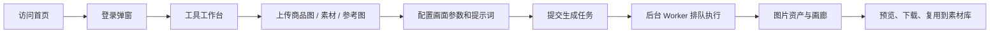

# 当前系统操作与运维说明

> 适用版本：`b213f5a`（2026-07-28）  
> 生产地址：[http://47.106.108.150:3000](http://47.106.108.150:3000)  
> 本文只说明已实现能力和安全操作，不包含密码、API Key、数据库连接串、OSS 密钥或服务器登录信息。

## 1. 系统定位

本系统是一个面向电商视觉生产与内容创作的 AI 工作台。它把商品选品、素材管理、男装与女装视觉生成、IP 创作、平台封面、自由创作、创作画布、图片资产和账号管理放在同一套账号体系下。

系统采用“公开首页 + 登录后工作台”的结构：访客可以先浏览首页；点击登录后以弹窗完成认证；登录成功才可以进入工具、图片和账户配置。系统没有公开注册入口，账户由管理员创建和管理。

## 2. 使用流程总览



日常推荐顺序：先在选品中心维护商品资料，需要反复复用的单张图再放入素材库；在具体工具中选择或上传参考图后生成；生成结果统一进入图片画廊，可继续作为后续创作的参考素材。

## 3. 页面与功能地图

### 3.1 公开页面

| 路径 | 用途 |
| --- | --- |
| `/` | 首页。默认展示公开首页，点击登录后打开登录弹窗。 |
| `/knowledge`、`/knowledge/[slug]` | 已发布知识库文章。 |
| `/projects` | 项目展示。 |
| `/services` | 服务说明。 |
| `/login` | 独立登录页，主要兼容直接访问和认证跳转。 |

### 3.2 账户与权限

| 路径 | 用途 |
| --- | --- |
| `/account` | 当前账号中心、进入工作台、退出登录。 |
| `/account/models` | 个人 AI 模型和 API Key 配置。 |
| `/account/users` | 管理员账号管理页面，仅 `ADMIN` 可访问。 |

### 3.3 创作与生产工具

| 分组 | 路径 | 已实现用途 |
| --- | --- | --- |
| 工作台 | `/tools` | 工具入口与任务导航。 |
| 男装视觉 | `/tools/menswear` | 男装主流程入口。 |
| 男装视觉 | `/tools/menswear/generate` | 男装商品视觉生成。 |
| 男装视觉 | `/tools/menswear/single-outfit` | 单品人物穿搭生成。 |
| 男装视觉 | `/tools/menswear/multi-outfit` | 一衣多搭组合生成。 |
| 男装视觉 | `/tools/menswear/flatlay-outfit-split` | 平铺多搭图识别并拆分为单张穿搭输出。 |
| 男装视觉 | `/tools/menswear/style-reference` | 按参考图复刻构图、风格或画面关系。 |
| 男装视觉 | `/tools/menswear/scene-image` | 场景化商品图。 |
| 女装视觉 | `/tools/womenswear` 及其子页面 | 与男装分开呈现的女装视觉流程，含生成、单品穿搭、多搭、平铺拆分、参考图和场景图。 |
| 百货零食 | `/tools/snack-grocery` | 零食、百货等非服装商品的独立内容与视觉流程。 |
| 内容创作 | `/tools/platform-cover-design` | 小红书等平台的封面设计。 |
| 内容创作 | `/tools/ip-factory` | IP 衍生创作，例如换装、动作、表情包和装饰设计。 |
| 内容创作 | `/tools/ip-prototype` | IP 原型项目、参考图和生成任务管理。 |
| 内容创作 | `/tools/ai-image` | 自由生图/编辑入口。 |
| 创作中心 | `/tools/creative-center/canvas` | 创作画布会话，组织图片、提示词与 Skill。 |
| 创作中心 | `/tools/creative-center/skills` | Skill 的新增、编辑、启停和管理。 |
| 选品 | `/tools/products` | 独立商品选品中心。 |
| 素材 | `/tools/menswear/materials` | 单张生图参考素材库。 |
| 模特 | `/tools/menswear/models` | 模特档案、脸部/身材参考及生成管理。 |
| 资产 | `/tools/image-gallery` | 统一查看、预览、下载、删除和复用生成图片。 |
| 历史 | `/tools/history/[toolId]` | 各工具的任务与生成历史。 |
| 其他 | `/tools/hotspots`、`/tools/plan`、`/tools/sites`、`/tools/release` | 热点、计划、网站收藏与发布辅助能力。 |

## 4. 商品、素材与图片资产

### 4.1 选品中心

选品中心用于管理“一个商品”的电商档案，和素材库是两个独立系统。

- 一个选品可以有多张图片，并设定主图。
- 选品可填写名称、一级自定义分类、描述、标签、卖点、适用人群、场景和搜索关键词。
- 用户先上传图片并填写基础内容，再**主动**点击“AI 分析选品”；AI 才会对图片集合生成可编辑的选品描述、可见卖点、适用场景、标签与关键词。
- 分析不是必填。全部字段均可手工填写和修改。
- 选品分类按账号隔离，用户可以创建、改名、排序和删除自己的分类。
- 选品详情支持把选中的图片**复制到素材库**。复制后是两份独立记录，删除或修改不会双向影响。

### 4.2 素材库

素材库用于保存可反复引用的单张视觉素材，例如商品、模特脸部、人物、场景、服装、IP 原图和参考图。

- 支持上传、预览、分类、搜索、编辑、删除和 AI 图片识别。
- 图片识别会尝试回填名称、分类、标签和选品描述；结果仍需人工确认。
- 可在支持上传图片的创作页面从素材库选择图片，以避免重复上传。
- 素材库与选品中心不自动同步，避免商品档案和创作引用互相误删。

### 4.3 图片画廊与历史

- 每次生图会创建任务，后端 Worker 逐项执行，完成后创建 `AiImageAsset` 图片资产。
- 画廊按当前用户展示生成结果，支持大图预览、下载、查看提示词、查看参考图及其用途、删除和复用到素材库。
- 工具历史用于回看某一功能的任务状态、提示词和结果；不要依赖浏览器页面状态保存生成任务，应以任务记录和画廊结果为准。
- 删除画廊记录会删除对应的对象引用；涉及 OSS 对象时由服务端按安全前缀处理，删除前需确认图片后续不再需要。

## 5. 生图工作方式

### 5.1 公共交互原则

所有图片生成工具应遵循相同的基本流程：

1. 先选择本次使用的主图、服装图、人物/脸部图和参考图；可本地上传，也可从素材库选择。
2. 填写场景、画面比例、人物占比、身材比例、动作、背景、构图、保留项与自定义说明。
3. 打开并检查提示词。提示词是可见、可编辑的，提交时以当前编辑内容为准。
4. 点击生成后，任务进入队列。离开页面不会取消后台任务；切回页面后从历史或画廊查看真实状态和图片。
5. 图片完成后到画廊预览、下载、删除或保存到素材库。

### 5.2 服装工具的关键约束

- 男装与女装使用独立入口、独立选项与文案，但基础参数保持一致，便于学习和维护。
- 人物大小提供环境感、均衡、人物突出和近景等范围；身材可选择标准写实、修长模特、运动肩宽、宽松风格或自定义说明。
- 参考图可以明确控制背景和构图：保持参考图不变，或按用户文字说明变化；动作也可指定或随机。
- 平铺多搭拆分流程以平铺图内的每一套搭配为依据，按识别数量分别输出单图，不应随机重复同一套。
- 单品穿搭可上传脸部参考图，选择露脸/无头、戴口罩/不戴口罩、人物占比、动作、背景和参考图构图。
- 平台封面、IP 衍生和自由生图也使用统一的比例、参考图和提示词机制，但各自保留业务专用选项。

### 5.3 图片比例

生成模型只接受其支持的尺寸。页面中的比例选项会映射为模型请求尺寸；使用前应按平台选择合适比例，例如竖版内容、小红书封面、方图、横版详情页等。参考图复刻时，若选择“保持构图/比例”，提示词与参数会优先约束画面关系，但生成模型仍可能存在少量偏差。

## 6. 登录、账号和权限

### 6.1 登录流程

1. 首页默认不进入工作台。
2. 用户点击登录，首页打开登录弹窗；直接访问受保护页面也会跳回首页并打开登录弹窗。
3. 输入账号或邮箱及密码，认证成功后回到原目标页；没有目标页时进入账户中心或工作台。
4. 弹窗可通过关闭按钮、点击遮罩或 `Esc` 关闭。

### 6.2 角色定义

- `USER`：可使用工作台、本人图片、本人素材、本人选品、本人模型配置与历史数据。
- `ADMIN`：包含 `USER` 权限，并可访问 `/account/users` 创建和管理账号。

数据按用户隔离。管理员不应把共享模型密钥写入普通用户账户；每个用户应在自己的模型配置页面保存自己的供应商 Key。

### 6.3 管理员操作

在 `/account/users` 可以：

- 新建用户账号。
- 修改姓名、账号/邮箱、角色和启用状态。
- 为用户重置密码。
- 禁用不再使用的账号。

安全规则：禁用账号、重置密码和变更角色会递增 `authVersion`，使旧 JWT 会话立即失效。系统不允许禁用或降级最后一个启用中的管理员。

登录失败次数、账号锁定、最近登录 IP、User-Agent 和登录审计会保留在数据库中供安全排查。系统没有公开注册功能。

## 7. AI 模型配置中心

路径：`/account/models`。

### 7.1 用户如何配置

1. 新增模型配置。
2. 选择供应商预设，或选择“自定义”。
3. 填写显示名、Base URL、模型名、API Key 和能力。
4. 为配置勾选实际可用能力，例如 `text`、`vision`、`image.generate`、`image.edit`。
5. 点击“测试连接”。测试通过后启用配置。

当前支持的预设类型：OpenAI Compatible、OpenAI、OpenRouter、Claude、Gemini、AIZHZO 和自定义兼容接口。实际可用性取决于供应商、模型名、Base URL 和该 Key 的权限。

### 7.2 选择规则与安全边界

- 请求某一能力时，系统优先选取当前用户已启用、且声明了该能力的模型配置。
- 当前用户没有匹配配置时，才会尝试服务器环境变量中的系统兜底配置。
- API Key 不返回到浏览器。数据库中使用 AES-256-GCM 加密保存，界面仅显示掩码预览。
- 删除或停用配置后，后续请求不再使用它。
- 模型配置只控制 AI 调用；OSS、数据库、搜索服务等基础设施仍由服务器环境配置管理。

配置建议：文本/视觉识别与图片生成通常需要不同模型能力。若生图提示“没有可用的 image.generate 模型配置”，请在模型中心新增并启用对应图片生成能力，而不是只配置文本模型。

## 8. 存储、OSS 与数据生命周期

### 8.1 当前存储架构

生产系统使用 PostgreSQL 保存用户、任务、提示词和图片元数据；图片文件优先写入阿里云 OSS。应用保存的图片 URL 通常是站内代理路径：

```text
/api/uploads/oss/<object-key>
```

代理路由在服务端读取 OSS 后返回图片，因此 Bucket 可保持私有，不需要把对象设置为公共读写。对象路径受到 `ALIYUN_OSS_PREFIX` 前缀校验，防止接口读取 Bucket 中无关文件。

### 8.2 必需的服务器环境变量

生产环境需要由运维人员在 `.env.production` 配置以下 OSS 变量，**只可在服务器保存，不可提交 Git**：

```text
ALIYUN_OSS_ACCESS_KEY_ID
ALIYUN_OSS_ACCESS_KEY_SECRET
ALIYUN_OSS_BUCKET
ALIYUN_OSS_ENDPOINT
ALIYUN_OSS_PREFIX
ALIYUN_OSS_PUBLIC_BASE_URL  # 可选
```

代码会在 OSS 未完整配置时回退到运行时文件存储。该回退仅适合临时恢复，不适合作为长期生产存储；容器重建或磁盘清理可能导致本地文件丢失。上线前应执行 `npm run oss:verify` 验证连接。

### 8.3 已有本地图片迁移

当旧图片仍指向 `/api/uploads/ai-images/...` 时，可由运维人员在确认备份后运行：

```powershell
npm run oss:migrate-runtime
npm run oss:convert-private-urls
```

迁移前后都必须抽样打开画廊、素材库和模特图片确认回显；确认 OSS 上存在对象且数据库 URL 已转换前，不得清理运行时目录。

## 9. 数据库、队列与部署架构

### 9.1 组件

| 组件 | 责任 |
| --- | --- |
| Next.js 应用 `my-web` | 页面、API、认证、AI 请求、OSS 代理。 |
| Worker `my-web-worker` | 每两秒调用内部任务接口，持续领取和执行图片生成任务。 |
| PostgreSQL `my-web-postgres` | Prisma 数据库、用户、任务、资产、素材、选品与审计。 |
| 阿里云 OSS | 生产图片对象存储。 |

生产 Docker Compose 文件为 `docker-compose.prod.yml`。应用和 Worker 通过同一镜像运行，运行时临时文件目录挂载为 `/opt/my-web/runtime`；PostgreSQL 使用命名卷持久化。

### 9.2 Prisma 与迁移

- 数据模型定义：`prisma/schema.prisma`。
- 迁移目录：`prisma/migrations`。
- 本次版本包含 `20260728090000_add_user_auth_version`，用于账户会话失效控制。
- 生产迁移应在发布窗口执行，并先做数据库备份；不要在生产库上使用会重置数据的 Prisma 命令。

### 9.3 生产发布流程

服务器目录约定：

```text
/opt/my-web/compose    # Compose 配置与生产环境变量
/opt/my-web/releases   # 镜像包与发布材料
/opt/my-web/backups    # 数据库备份
/opt/my-web/runtime    # 仅临时运行时文件，不是长期图片仓库
```

推荐发布步骤：

1. 在本地 `main` 分支完成测试和 `next build`。
2. 构建 Docker 镜像，并导出为离线镜像包上传到 `/opt/my-web/releases`。
3. 在服务器导入镜像，更新 `/opt/my-web/compose/.runtime/release.env` 中的 `IMAGE_TAG` 与 `RELEASE_COMMIT`。
4. 先备份 PostgreSQL，再执行受控 Prisma 迁移。
5. 执行 `docker compose -f docker-compose.prod.yml up -d` 重建应用和 Worker。
6. 检查 `my-web`、`my-web-worker`、`my-web-postgres` 状态，访问首页并用测试账号完成一次登录与生图提交。

不要在生产服务器上执行耗时的 `npm install` 或 `next build`。发布镜像应在本地构建，以减小线上构建失败和依赖漂移风险。

### 9.4 回滚原则

每次迁移前保留数据库压缩备份，并记录旧镜像标签。出现发布故障时：

1. 先停止继续写入和继续执行迁移。
2. 将发布环境变量切回上一镜像标签，重新拉起 Web 和 Worker。
3. 仅当迁移确实造成数据问题时，使用对应时间点备份恢复数据库。
4. 恢复后验证登录、任务队列、画廊、素材库和 OSS 图片代理。

## 10. 本地开发与验证

常用命令：

```powershell
npm install
npm run dev
npm test
npm run lint
npm run build
npm run prisma:generate
npm run verify:prisma
npm run oss:verify
```

本地 `.env`、生产 `.env.production`、镜像包、运行时图片、日志和临时备份都属于环境资料，禁止提交。提交前应检查：

```powershell
git status --short
git diff --check
```

## 11. 日常维护清单

### 管理员

1. 在账户管理页创建用户，不通过共享管理员账号给多人使用。
2. 停用离职或不再授权的账户，并重置疑似泄露的密码。
3. 定期查看登录审计和任务失败记录。
4. 定期备份数据库，确认 OSS 生命周期策略与预算告警。

### 普通用户

1. 在模型中心配置自己的 AI Key，并用测试连接确认可用。
2. 上传前确认素材权利和人物授权；模特/脸部参考只用于已获得授权的素材。
3. 在生成前检查主图、参考图和提示词；生成后在画廊检查结果再下载或复用。
4. 对不再需要的生成结果使用画廊删除，避免不必要的 OSS 存储与流量成本。

### 故障排查顺序

| 现象 | 首先检查 |
| --- | --- |
| 点击生成无结果 | 用户是否登录、是否启用了 `image.generate` 模型、任务历史的失败信息、Worker 容器日志。 |
| AI 识别失败 | 是否有启用的 `vision` 模型、图片是否有效、模型接口是否支持多模态。 |
| 图片 404 或不回显 | 数据库存储的 URL、OSS 环境变量、OSS 对象是否存在、`/api/uploads/oss/...` 是否返回正常。 |
| 登录后立即失效 | 账号是否被禁用、密码/角色是否刚修改、`AUTH_SECRET` 是否保持稳定、数据库是否可访问。 |
| 页面功能与预期不一致 | 确认当前访问的是生产地址、浏览器是否有旧缓存、页面是否提交了当前提示词；再检查生产 `RELEASE_COMMIT`。 |

## 12. 当前版本记录

- Git 分支：`main`
- 应用提交：`b213f5a feat: add self-service AI and user management`
- 发布镜像标签：`20260728-b213f5a`
- 生产服务：`my-web`、`my-web-worker`、`my-web-postgres`
- 已完成验证：相关测试 43 项通过、`next build` 通过、生产数据库迁移成功、首页 HTTP 200、未认证账户管理 API 正确返回 401。

后续新增功能时，应同步更新本说明，至少补充：页面入口、权限、输入输出、数据归属、图片存储方式、失败提示和部署迁移要求。
