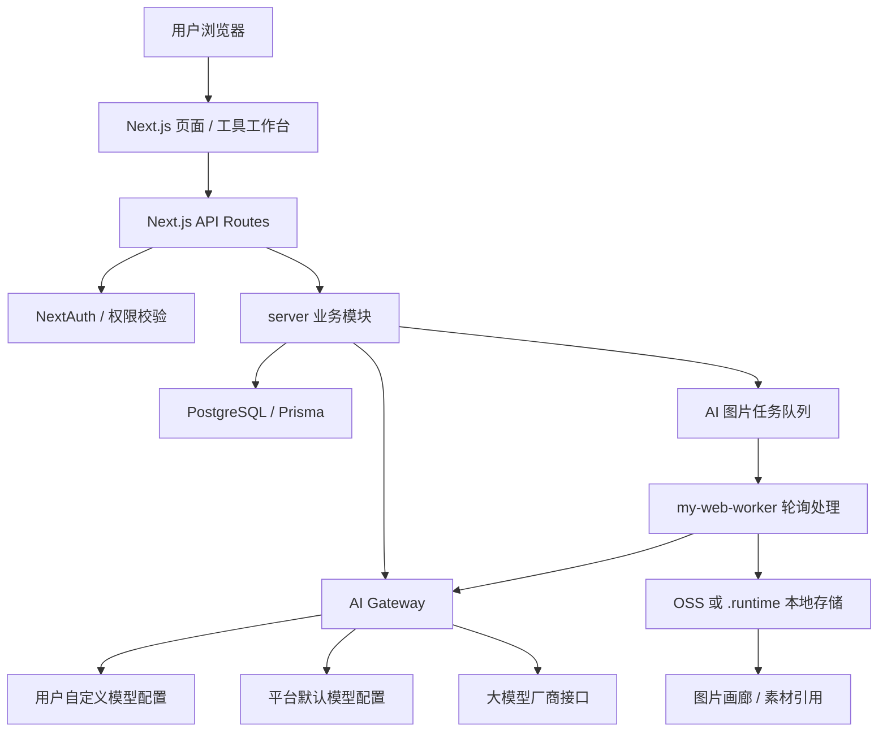
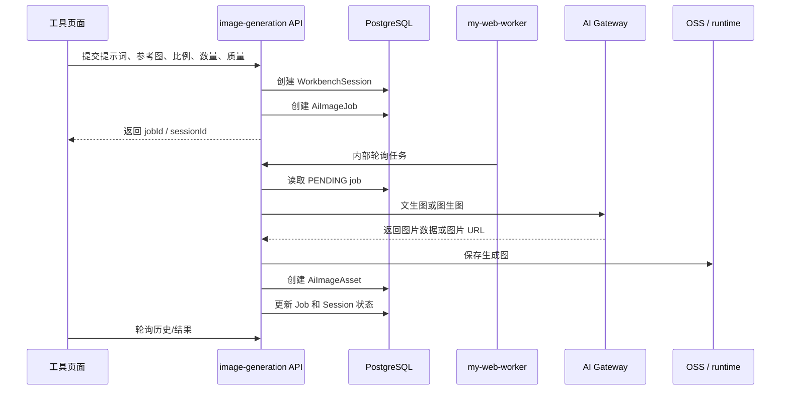

# 当前系统详细分析与说明

更新时间：2026-07-31  
项目路径：`E:\my_web`  
线上地址：`http://47.106.108.150:3000`  
当前主分支：`main`  
当前线上镜像：`my-web:20260730-a9ffe01`

本文档用于说明当前系统的真实结构、功能边界、AI 模型配置方式、图片存储、部署方式、已知风险和后续优化建议。文档不记录任何真实 API Key、服务器密码、OSS Secret 或账号密码。

## 1. 系统定位

当前系统是一个面向内容创作、电商视觉、商品选品和 AI 图片生产的内部工作台。核心目标不是做一个单一生图页面，而是把常用创作流程沉淀成可复用工具：

- 内容创作：AI 生图、平台封面、IP 原型、IP 衍生、热点查询、系列视频分析、情绪解压。
- 商品视觉：男装视觉、女装视觉、零食百货、小红书/闲鱼、资料包生成。
- 资源管理：选品中心、图片画廊、素材/模特/参考图管理。
- 画布与 Skill：把创作能力抽象成 Skill，在画布中组合调用。
- 账户设置：模型配置、登录用户、图片清理、用户中心。

系统目前是“多工具工作台 + AI 网关 + 图片资产库 + 工作流历史”的形态。

## 2. 技术栈

### 2.1 前端与服务端

- 框架：Next.js App Router。
- UI：React、Tailwind CSS、lucide-react 图标。
- 数据请求：SWR、fetch。
- 后端：Next.js Route Handler + Server 模块。
- 鉴权：NextAuth Credentials 登录。
- ORM：Prisma。
- 数据库：PostgreSQL。
- 部署：Docker 镜像 + docker compose。

### 2.2 关键目录

```text
src/app                         页面和 API 路由
src/components                  前端组件
src/components/tools            工具工作台组件
src/components/account          账户、模型、用户配置组件
src/server                      服务端业务逻辑
src/server/ai-gateway           AI 模型调用网关
src/lib                         纯逻辑、提示词、流程配置、工具函数
prisma/schema.prisma            数据模型
tests                           单元测试和流程测试
docs                            项目文档
docker-compose.prod.yml         生产服务编排
Dockerfile                      生产镜像构建
```

## 3. 总体架构



核心设计是：

- 页面只负责收集参数、展示提示词、展示生成状态和历史。
- API 负责鉴权、校验、写入工作台会话、创建图片任务。
- Worker 负责真实生图，避免页面请求长时间阻塞。
- AI Gateway 统一模型路由，支持平台默认模型和用户自己的模型。
- 图片优先走 OSS；如果 OSS 没配置，才回退到服务器 `.runtime`。

## 4. 登录与权限

### 4.1 登录方式

登录使用 NextAuth Credentials Provider，账号和密码保存在数据库 `User` 表中。

关键文件：

```text
src/server/auth.ts
src/server/admin-login-security.ts
src/server/auth-permissions.ts
src/app/api/auth/[...nextauth]/route.ts
src/app/login/page.tsx
```

### 4.2 权限角色

数据库中 `User.role` 控制权限。当前至少存在：

- `ADMIN`：管理权限，可进入用户管理、系统配置等。
- `USER`：普通工具使用权限。

### 4.3 登录安全

当前已有：

- 登录失败审计：`LoginAudit`。
- 登录失败次数：`failedLoginCount`。
- 锁定时间：`lockedUntil`。
- 禁用用户：`disabledAt`。
- 会话版本：`authVersion`，用于强制旧会话失效。
- 登录 IP 和 User-Agent 记录。

注意：服务器 SSH 登录日志显示存在外部失败尝试。生产服务器应长期使用 SSH Key 登录、关闭密码登录、限制安全组来源 IP。

## 5. 导航与页面结构

导航配置在：

```text
src/components/tools/nav-config.ts
```

当前导航分组：

| 分组 | 页面 |
| --- | --- |
| 总览 | `/tools` |
| 计划 | `/tools/plan` |
| 内容创作 | AI 生图、平台封面设计、IP 原型、IP 衍生工厂、系列视频分析、热点查询、情绪解压 |
| 画布与 Skill | 创作画布、Skill 管理 |
| 商品视觉 | 男装视觉工作台、选品中心、女装视觉工作台、零食百货、小红书/闲鱼、资料包生成 |
| 资源管理 | 网站库、图片画廊 |
| 账户设置 | 模型配置、登录用户、图片清理、用户中心 |

当前系统的主要问题不是页面不够多，而是功能逐步扩展后，用户路径容易变长。后续应继续收敛成“先选择目标，再进入简化流程”的交互。

## 6. AI 模型系统

### 6.1 平台默认模型

平台默认模型从服务器环境变量读取。生产路径：

```text
/opt/my-web/compose/.env.production
```

重要变量：

```env
AI_TEXT_API_KEY=
AI_TEXT_BASE_URL=
AI_TEXT_MODEL=
TEXT_API_PATH=

AI_IMAGE_API_KEY=
AI_IMAGE_BASE_URL=
AI_IMAGE_MODEL=
IMAGE_API_PATH=
IMAGE_EDIT_API_PATH=

AIZHZO_API_KEY=
AIZHZO_BASE_URL=
AIZHZO_CHAT_MODEL=
AIZHZO_IMAGE_MODEL=
AIZHZO_IMAGE_GENERATION_PATH=
AIZHZO_IMAGE_EDIT_PATH=

AI_CREDENTIAL_ENCRYPTION_KEY=
AUTH_SECRET=
NEXTAUTH_SECRET=
```

当前使用逻辑：

- 文本/Agent/识图优先读 `AI_TEXT_API_KEY`。
- 生图/图生图优先读 `AI_IMAGE_API_KEY`。
- `AIZHZO_API_KEY` 是旧配置兜底。
- 如果没有配置专用 Key，系统会回退使用共享 Key。

关键文件：

```text
src/server/ai-gateway/provider-registry.ts
src/server/ai-model-configs.ts
```

### 6.2 用户自定义模型

页面：

```text
/account/models
```

数据表：

```text
AiProviderCredential
AiModelRoute
```

用户可以新增模型配置：

- 厂商预设。
- 底层接口类型。
- 配置名称。
- Base URL。
- 模型 ID。
- 聊天/视觉接口路径。
- 文生图接口路径。
- 图生图接口路径。
- API Key。
- 支持能力。

API Key 只加密保存在服务端，不会回显明文。更新时 API Key 留空表示保留旧 Key。

### 6.3 当前支持的底层 Provider

系统运行时真正识别的 Provider 是稳定协议类型：

```text
openai-compatible
openai
openrouter
anthropic
google
aizhzo
custom
```

这不是厂商列表，而是“调用适配器”。多数国内外厂商都走 `openai-compatible`。

### 6.4 厂商预设

预设文件：

```text
src/lib/ai-provider-presets.ts
```

已预留：

- OpenAI 文本/视觉。
- OpenAI 图片。
- AIZHZO 图片。
- OpenRouter。
- DeepSeek。
- 阿里百炼/通义千问。
- Kimi/月之暗面。
- 智谱 GLM。
- 火山方舟/豆包。
- 硅基流动。
- 百度千帆/文心。
- 腾讯混元。
- MiniMax。
- Claude/Anthropic。
- Gemini OpenAI 兼容。
- Gemini 原生。
- Mistral。
- Together AI。
- xAI/Grok。
- Groq。
- Perplexity。
- 自定义 OpenAI 兼容接口。

当前预设是“可选模板”：选择后会填充表单，但用户仍可修改所有字段。保存时系统保存的是修改后的配置，不是保存预设 ID。

### 6.5 模型路由

模型路由按能力拆分：

- `text`：文本 / Agent。
- `vision`：图片识别。
- `image.generate`：文生图。
- `image.edit`：图生图 / 参考图。
- `tools`：工具调用预留。
- `audio.transcribe`、`audio.speech`、`embedding`、`video.generate`：能力预留。

每种能力可选：

- 自动选择：用户模型优先，缺失时走系统默认。
- 系统默认。
- 指定某个用户模型。

这能解决“文本模型和图片模型不同厂商”的问题。

### 6.6 当前不足

目前“厂商预设”是代码内置，不是数据库可编辑。用户可以基于预设保存自己的模型配置，但不能在前端永久修改系统预设本身。

建议后续增加：

- `AiProviderPreset` 数据表。
- 系统预设只读。
- 我的预设可增删改查。
- 从系统预设复制成我的预设。
- 导入/导出预设 JSON。

这样后期换厂商、改模型名、调整路径就完全不需要改代码。

## 7. AI 图片生成链路

### 7.1 主要入口

通用生图 API：

```text
src/app/api/tools/image-generation/route.ts
```

队列处理：

```text
src/server/ai-image-queue.ts
src/app/api/internal/ai-image-worker/route.ts
```

AI 图片工具：

```text
src/server/ai-image-tools.ts
```

图片资产：

```text
src/server/ai-image-assets.ts
```

### 7.2 标准流程



### 7.3 图片比例和质量

比例映射在：

```text
src/lib/image-aspect-ratios.ts
```

图片大小由 `normalizeImageSize()` 转换为上游模型支持的 size。系统应继续保证小红书、电商主图、横版封面等比例选择明确。

### 7.4 批量生成

当前单个任务最大生成数量限制：

```text
1 - 30
```

平铺多搭拆分模式会在每张图提示词中追加序号要求，避免重复生成同一套。

## 8. 图片存储与 OSS

### 8.1 当前策略

关键文件：

```text
src/server/oss-storage.ts
src/server/ai-image-tools.ts
src/app/api/uploads/oss/[...objectKey]/route.ts
```

如果 OSS 环境变量齐全，系统将图片上传到 OSS，并通过代理 URL 访问：

```text
/api/uploads/oss/<objectKey>
```

如果 OSS 没配置，才回退到：

```text
.runtime/uploads/ai-images
/api/uploads/ai-images/<fileName>
```

### 8.2 OSS 必需变量

```env
ALIYUN_OSS_ACCESS_KEY_ID=
ALIYUN_OSS_ACCESS_KEY_SECRET=
ALIYUN_OSS_BUCKET=
ALIYUN_OSS_ENDPOINT=
ALIYUN_OSS_PUBLIC_BASE_URL=
ALIYUN_OSS_PREFIX=
```

当前目标 Bucket 是 `design-yshine`，但文档不记录真实 AccessKey。

### 8.3 为什么之前会出现线上图片 404

历史问题原因通常是：

- 图片生成后保存到了容器本地 `.runtime`，容器重建或服务器清理后文件消失。
- 数据库中仍保存 `/api/uploads/ai-images/...` 这种本地路径。
- 未迁移旧图片到 OSS。
- OSS 私有 Bucket 未通过代理读取，直接公网 URL 可能无权限。

当前方案是：

- 新图片优先入 OSS。
- 私有 OSS 通过 `/api/uploads/oss/...` 代理读取。
- 老的 runtime URL 可以通过迁移脚本处理。

相关脚本：

```text
pnpm oss:verify
pnpm oss:migrate-runtime
pnpm oss:convert-private-urls
```

## 9. 工作台会话与历史记录

### 9.1 WorkbenchSession

数据表：

```text
WorkbenchSession
```

用途：

- 保存每个工具的输入快照。
- 保存提示词。
- 保存输出快照。
- 绑定生成图片 asset ID。
- 记录任务状态。
- 支持历史页面恢复。

关键字段：

- `toolId`
- `title`
- `status`
- `prompt`
- `inputSnapshot`
- `outputSnapshot`
- `imageAssetIds`
- `externalJobId`
- `errorMessage`

### 9.2 历史页面

统一历史入口：

```text
/tools/history/[toolId]
```

当前设计方向正确：每个功能应统一通过 `WorkbenchSession` 保存历史，而不是每个页面各写一套历史逻辑。

### 9.3 当前不足

部分历史记录只存输入和图片 ID，对“中间步骤、用户改过的提示词版本、失败时上游响应摘要”记录还不够完整。建议后续统一扩展：

- 每次点击生成保存一条 action。
- 每次修改提示词保存版本。
- 每张生成图记录使用的最终 prompt、参考图、模型、比例、质量。
- 失败记录保存公共错误信息和内部错误 ID。

## 10. 核心数据模型

### 10.1 用户与权限

```text
User
Account
Session
LoginAudit
```

用途：

- 登录账号。
- 角色权限。
- 会话管理。
- 登录审计和锁定。

### 10.2 图片与任务

```text
AiImageAsset
AiImageJob
```

用途：

- `AiImageJob`：排队任务和状态。
- `AiImageAsset`：生成图、参考图、提示词、标签、标题、下载地址。

### 10.3 男装/女装视觉

```text
MenswearMaterial
MenswearModelProfile
MenswearProject
MenswearModelProfileImage
MenswearProjectReference
MenswearPromptVersion
```

虽然表名是 Menswear，但女装页面当前复用/镜像了类似流程。长期看应抽象为 `FashionMaterial`、`FashionModelProfile`、`FashionProject`，用 `genderSegment` 区分男装、女装，而不是长期复制男装命名。

### 10.4 选品中心

```text
ProductCategory
Product
ProductImage
```

用途：

- 用户自定义分类。
- 商品多图。
- 主图。
- 描述、卖点、场景、关键词、AI 分析结果。

选品中心与素材库是两个系统：

- 选品中心：商品档案管理。
- 素材库：生图参考素材。

两边可手动复制，但不应自动混用。

### 10.5 IP 原型与衍生

```text
IpPrototypeProject
IpPrototypeGeneration
```

用途：

- 记录 IP 项目。
- 记录生成图、prompt、参考图、风格要求。

### 10.6 Skill 与画布

```text
CreativeSkill
CreativeSkillVersion
CreativeCanvasSession
CreativeCanvasNode
CreativeCanvasEdge
CreativeCanvasRun
```

用途：

- Skill 定义和版本。
- 画布会话。
- 节点、连线、运行记录。

当前方向是正确的，但交互需要继续优化成“无限画布 + 节点可拖拉 + 图片可摆放 + 选择 Skill 运行 + 输出回到画布”。

## 11. 主要功能模块说明

### 11.1 AI 生图

页面：

```text
/tools/ai-image
```

能力：

- 文生图。
- 图生图/参考图。
- 多比例。
- 批量生成。
- 保存到图片画廊。
- 历史记录。

后续建议：

- 默认只展示最必要参数。
- 高级参数折叠。
- 生成按钮后允许继续追加新任务进入队列。
- 生成进度需要稳定缓存，切页面后继续显示。

### 11.2 男装视觉工作台

页面：

```text
/tools/menswear
/tools/menswear/generate
/tools/menswear/single-outfit
/tools/menswear/multi-outfit
/tools/menswear/flatlay-outfit-split
/tools/menswear/style-reference
/tools/menswear/scene-image
/tools/menswear/materials
/tools/menswear/models
```

能力：

- 男装主图/生图。
- 单张人物穿搭参考。
- 一衣多搭。
- 平铺多搭拆分生图。
- 参考图复刻。
- 场景图。
- 素材库。
- 模特档案和模特脸部参考。

当前重点要求：

- 上传服装图后生成真实穿搭。
- 参考图可控制构图、背景、动作是否保持或变化。
- 支持有头/无头、男/女模特、脸部参考、戴口罩、人物占比、身材比例。
- 生成图能入素材库继续复用。

### 11.3 女装视觉工作台

页面：

```text
/tools/womenswear
/tools/womenswear/generate
/tools/womenswear/single-outfit
/tools/womenswear/multi-outfit
/tools/womenswear/flatlay-outfit-split
/tools/womenswear/style-reference
/tools/womenswear/scene-image
```

当前女装流程与男装保持一致，但提示词和选项应继续女装化：

- 女装版型。
- 面料垂坠。
- 身材比例。
- 女性穿搭场景。
- 小红书/电商封面审美。

长期建议复用同一个 `fashion` 底层流程，通过品类参数区分男装/女装，减少重复维护。

### 11.4 平铺多搭拆分生图

需求定义：

- 上传一张多套平铺穿搭图。
- 系统识别其中有几套。
- 每套单独生成一张人物穿搭图。
- 可上传脸部、背景、参考图。
- 背景、构图、动作分别可选保持或变化。
- 每张图只使用对应套装，不随机重复。

当前链路已经通过 `splitOutfitMode` 在队列中追加序号约束，但前端交互和视觉反馈仍需继续优化，尤其是：

- 用户要看到系统识别出的套数。
- 每套应有独立预览框。
- 生成结果不要带边框和拼图感。
- 人物占比需要更明确控制。

### 11.5 选品中心

页面：

```text
/tools/products
/tools/products/new
/tools/products/[id]
```

能力：

- 用户自定义分类。
- 创建商品选品。
- 上传 1 到多张商品图。
- 设置主图。
- AI 识别商品。
- 自动生成描述、标签、卖点、场景、关键词。
- 可编辑后保存。

正确流程应是：

1. 上传图片。
2. 填写或选择分类。
3. 填写基础内容。
4. 点击 AI 识别商品。
5. 系统回填选品描述、卖点、标签、关键词等。
6. 用户修改。
7. 保存商品档案。

该流程不应强制用户必须用 AI；手动填写也应完整可用。

### 11.6 素材库

当前主要在男装素材中：

```text
/tools/menswear/materials
```

能力：

- 上传图片。
- 图片回显预览。
- 分类。
- AI 分析图片。
- 保存为素材。
- 从素材库选择参考图。

注意：

- 素材库和选品中心分开。
- 素材库服务于生图参考。
- 选品中心服务于商品管理。
- 生成图可以手动进入素材库。

### 11.7 平台封面设计

页面：

```text
/tools/platform-cover-design
```

定位：

- 小红书、抖音、视频号、闲鱼等平台封面。
- 上传封面原图。
- 可上传参考图。
- 可模仿参考图风格和版式。
- 支持修改标题、卖点、内容信息。

当前需要避免的问题：

- 不应只像单一场景模板。
- 应提供多平台、多风格、多版式预设。
- 应明确“参考图模仿哪些元素”：构图、文字层级、配色、贴纸、光影、版式，而不是照搬人物或品牌。

### 11.8 IP 原型与 IP 衍生

页面：

```text
/tools/ip-prototype
/tools/ip-factory
```

IP 原型：

- 创建 IP 基础设定。
- 生成角色原型。
- 保存项目和生成记录。

IP 衍生：

- 主 IP 图决定角色身份、脸部、比例、线条、上色和原始画风。
- 参考图只迁移服装版型、颜色、材质层次、搭配关系和指定配饰。
- 禁止迁移参考真人五官、摄影感、背景、光影和参考图画风，除非用户明确要求。

后续建议：

- 把“换装、动作、表情包、装饰、场景、节日、周边”做成清晰标签式功能入口。
- 输出数量默认多一点，但给用户明确控制。

### 11.9 画布与 Skill

页面：

```text
/tools/creative-center/canvas
/tools/creative-center/skills
```

目标：

- 类似即梦画布的无限画布体验。
- 图片上传后显示在画布上。
- 图片可拖动、缩放、编辑。
- 可选择 Skill 对节点执行。
- 输出图片回到画布。
- 底部保留自由提示词输入。

当前不足：

- 画布感还需要加强。
- 节点操作、图片拖拉、缩放、输出回填要继续完善。
- Skill 的“调用关系”和“运行结果”需要更直观。

## 12. API 结构

### 12.1 账户与模型

```text
GET/POST     /api/ai-model-configs
GET/PUT/DELETE /api/ai-model-configs/[id]
POST         /api/ai-model-configs/[id]/test
GET          /api/ai-model-configs/active
POST         /api/ai-model-configs/active/test
PUT          /api/ai-model-configs/routes
GET/POST     /api/account/users
PUT/DELETE   /api/account/users/[id]
```

### 12.2 图片与生图

```text
POST         /api/tools/image-generation
POST         /api/internal/ai-image-worker
GET/DELETE   /api/tools/image-assets
GET/DELETE   /api/tools/image-assets/[id]
GET          /api/tools/image-assets/download-zip
GET          /api/uploads/ai-images/[fileName]
GET          /api/uploads/oss/[...objectKey]
```

### 12.3 商品与素材

```text
GET/POST     /api/tools/product-categories
GET/POST     /api/tools/products
GET/PUT/DELETE /api/tools/products/[id]
POST         /api/tools/products/upload
POST         /api/tools/products/analyze

GET/POST     /api/tools/menswear/materials
GET/PUT/DELETE /api/tools/menswear/materials/[id]
POST         /api/tools/menswear/materials/upload
POST         /api/tools/menswear/materials/analyze
POST         /api/tools/menswear/materials/from-asset
```

### 12.4 男装/模特/项目

```text
GET/POST     /api/tools/menswear/models
GET/PUT/DELETE /api/tools/menswear/models/[id]
POST         /api/tools/menswear/models/[id]/generate
GET/POST     /api/tools/menswear/projects
GET/PUT/DELETE /api/tools/menswear/projects/[id]
POST         /api/tools/menswear/projects/[id]/generate
POST         /api/tools/menswear/multi-outfit/analyze
```

### 12.5 IP、画布、Skill

```text
GET/POST     /api/tools/ip-prototypes
GET/PUT/DELETE /api/tools/ip-prototypes/[id]
POST         /api/tools/ip-prototypes/[id]/generate
GET          /api/tools/ip-prototypes/tasks
GET          /api/tools/ip-prototype-generations/[id]

GET/POST     /api/tools/creative-skills
GET/PUT/DELETE /api/tools/creative-skills/[skillId]
POST         /api/tools/creative-skills/[skillId]/toggle
GET/POST     /api/tools/creative-canvases
GET/PUT      /api/tools/creative-canvases/[sessionId]
POST         /api/tools/creative-canvases/[sessionId]/agent-plan
```

## 13. 部署说明

### 13.1 生产服务

生产 compose：

```text
docker-compose.prod.yml
```

服务：

- `my-web-postgres`：PostgreSQL。
- `my-web`：Next.js Web/API。
- `my-web-worker`：轮询 `/api/internal/ai-image-worker` 处理图片任务。

### 13.2 生产路径

```text
/opt/my-web/compose/docker-compose.prod.yml
/opt/my-web/compose/.env.production
/opt/my-web/compose/release-current.env
/opt/my-web/compose/release-previous.env
/opt/my-web/releases/<tag>
/opt/my-web/runtime
```

### 13.3 当前部署方式

当前使用“本地构建 Docker 镜像，上传服务器 docker load”的方式：

1. 本地 `pnpm build` 验证。
2. WSL 构建 Docker 镜像。
3. 导出 tar。
4. 上传到服务器 release 目录。
5. 服务器 `docker load`。
6. 更新 `release-current.env`。
7. 重建 `my-web` 和 `my-web-worker`。

### 13.4 重启命令

改 `.env.production` 后需要重启应用服务：

```bash
cd /opt/my-web/compose
docker compose --env-file ./.env.production --env-file ./release-current.env -f docker-compose.prod.yml up -d --force-recreate --no-deps my-web my-web-worker
```

不要重启或删除数据库 volume，除非已经有明确备份和迁移方案。

## 14. 当前系统主要问题分析

### 14.1 功能过多导致路径复杂

现状：

- 男装、女装、零食百货、IP、封面、画布、选品、素材库都在快速增长。
- 很多功能参数丰富，但首次使用的人不容易理解先做什么。

建议：

- 每个工具统一成三段式：
  1. 上传/选择素材。
  2. 填写目标和关键选项。
  3. 展开提示词，点击生成。
- 高级参数默认折叠。
- 页面顶部只保留“当前功能目标”和“开始生成”相关操作。

### 14.2 选品中心和素材库边界需要持续强调

选品中心是商品档案，素材库是生图素材。当前两套数据模型已经分开，这是正确的。但 UI 上需要持续强调：

- 选品中心：管理商品、分类、卖点、关键词、多图。
- 素材库：管理可复用图片参考。
- 复制到素材库是主动操作，不自动同步。

### 14.3 图片存储历史包袱

过去使用 runtime 本地路径导致过 404。现在 OSS 方案正确，但需要完成：

- 老图片 URL 迁移。
- OSS 私有代理校验。
- 清理服务器旧 runtime 图片。
- 画廊批量删除和 OSS 删除一致性。

### 14.4 模型配置还缺“我的预设管理”

当前模型配置已经支持用户自定义模型和预设填充，但系统预设仍是代码内置。

建议下一阶段：

- 新增模型预设管理页面。
- 支持保存“我的常用厂商配置”。
- 支持复制系统预设。
- 支持测试每个能力。
- 支持记录最近一次错误，方便排查。

### 14.5 画布还没有形成核心体验

用户期望是即梦式无限画布，但当前更像普通工具页面。

建议：

- 画布作为独立顶级体验。
- 图片上传后直接成为画布节点。
- 节点支持拖拽、缩放、预览、删除。
- Skill 作为右侧工具栏或节点菜单调用。
- 运行结果回到画布。
- 节点保存到数据库，刷新后恢复位置。

### 14.6 生图任务状态需要更强缓存

当前已通过 Job 和 WorkbenchSession 保存状态，但前端页面切换后的恢复体验还应加强：

- 页面进入时自动读取最近 RUNNING 任务。
- 工具页顶部显示进行中的任务。
- 图片生成完成后自动刷新画廊。
- 失败时给出可操作原因。

## 15. 推荐优化路线

### 第一阶段：稳定和可维护

目标：减少“不能用、看不到图、切模型不稳定”的风险。

- 完成 OSS 旧图片迁移和清理。
- 图片资产删除时同步删除 OSS 对象。
- 模型配置增加“我的预设管理”。
- 每个能力提供测试按钮，并记录最近错误。
- 统一生成任务状态栏。

### 第二阶段：简化流程

目标：让每个工具不用解释也能用。

- 男装/女装/零食百货统一为商品视觉底层流程，但导航仍分开。
- 每页只保留必要选项。
- 高级参数折叠。
- 提示词默认展开但视觉上更清晰。
- 每页明确“上传什么、生成什么、参考什么”。

### 第三阶段：画布重做

目标：真正形成“创作操作台”。

- 无限画布。
- 图片节点。
- Prompt 节点。
- Skill 节点。
- 结果节点。
- 节点之间可连线。
- 输出可再次作为输入。

### 第四阶段：运营和资产体系

目标：从工具集合变成可长期使用的生产系统。

- 选品中心和素材库增加批量管理。
- 每个生成图可标记用途、平台、商品、项目。
- 图片资产支持 OSS 用量统计。
- 生成成本统计。
- 登录用户权限和额度控制。

## 16. 日常维护手册

### 16.1 本地启动

```bash
pnpm dev
```

默认端口可能被占用时，Next 会自动使用其他端口。

### 16.2 本地构建检查

```bash
pnpm build
```

### 16.3 常用测试

```bash
pnpm test
```

针对模型和图片链路：

```bash
pnpm exec tsx --test tests/ai-provider-presets.test.ts tests/ai-model-configs.test.ts tests/ai-gateway.test.ts tests/ai-image-tools.test.ts tests/ai-image-assets.test.ts tests/oss-storage.test.ts
```

### 16.4 OSS 检查

```bash
pnpm oss:verify
```

### 16.5 生产日志

```bash
cd /opt/my-web/compose
docker compose --env-file ./.env.production --env-file ./release-current.env -f docker-compose.prod.yml logs --tail=200 my-web
docker compose --env-file ./.env.production --env-file ./release-current.env -f docker-compose.prod.yml logs --tail=200 my-web-worker
```

### 16.6 查看生产服务

```bash
cd /opt/my-web/compose
docker compose --env-file ./.env.production --env-file ./release-current.env -f docker-compose.prod.yml ps
docker compose --env-file ./.env.production --env-file ./release-current.env -f docker-compose.prod.yml images
```

## 17. 安全注意事项

不要把以下内容写进 Git：

- API Key。
- OSS AccessKey。
- 服务器密码。
- 数据库连接串。
- NextAuth Secret。
- 用户密码。

这些只应该存在于：

- 本地 `.env.local`。
- 服务器 `/opt/my-web/compose/.env.production`。
- 私有备份文件。

生产服务器建议：

- 禁用 SSH 密码登录。
- 只允许 SSH Key。
- 安全组限制访问来源。
- 定期备份数据库。
- 定期清理旧镜像和旧 release 包，但不要删除数据库 volume。

## 18. 当前结论

系统核心能力已经具备：

- 用户登录和权限控制。
- 平台默认模型和用户自定义模型。
- 多厂商模型预设。
- 文生图、图生图、参考图生成。
- 图片队列和 worker。
- OSS 图片存储。
- 图片画廊和历史记录。
- 男装/女装/选品/IP/封面/画布等业务入口。

当前最需要补强的是产品层：

- 简化流程。
- 明确功能边界。
- 稳定图片存储和任务状态。
- 完成“我的模型预设管理”。
- 重做画布交互。

建议下一步优先做“模型预设管理 + 图片资产清理一致性 + 生图任务状态条”，这三个会直接提高系统稳定性和后期可维护性。

